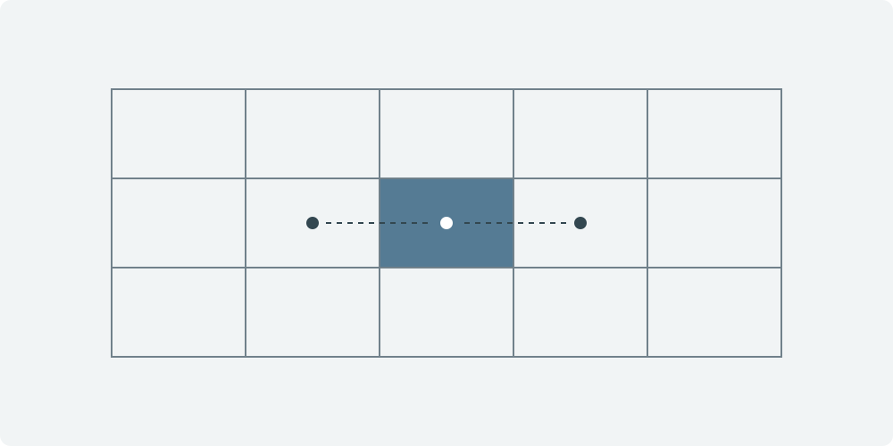

<!-- DRAFT_AUTHORING_EXAMPLE_8F2C -->

This is an authoring reference, not a project article. Keep this file unpublished. Copy it to start a new article, replace the examples with your own material, and set `draft: false` only when the article is ready.

## Equations

Use single dollar signs for inline mathematics, such as the grid spacing $\Delta x$. Use double dollar signs for a display equation:

$$
\frac{\partial u}{\partial x}\bigg|_{i}
\approx \frac{u_{i+1} - u_{i-1}}{2\Delta x}.
$$

This centered difference is a formatting example; it makes no claim about Fogcast's implementation or results.

## Code

Add a language after the opening fence to enable syntax highlighting.

```python
def centered_difference(left, right, spacing):
    """Estimate a derivative from neighboring cell values."""
    return (right - left) / (2 * spacing)
```

Code blocks scroll horizontally when a line is wider than the article column.

## Figures

Keep article figures in `src/assets/figures/`. Use descriptive alt text, a relative path from this Markdown file, and a quoted image title for the caption.



## Categories and series

The frontmatter assigns this example to the Fogcast category and to part 1 of the Fogcast notes series. Category and series pages appear when their first article is published. Keep the same series name and slug across articles, and use a positive integer for each article's reading order.

Articles with a future `pubDatetime` stay out of public pages and feeds until a build runs after that time. Draft articles can be previewed at their normal URL while running the development server.
