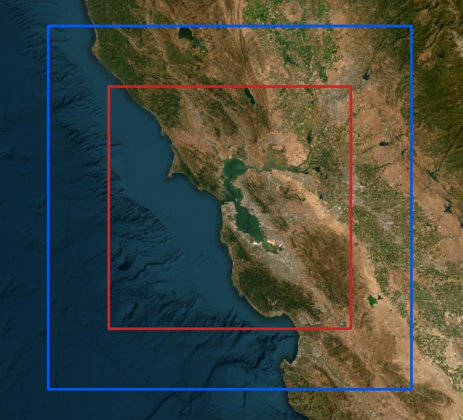

<!-- Source: article-drafts/Post-1_Build-Labels.docx. The publication date is a draft placeholder; update it before publishing. -->

## A forecast for the BBQ

I’ve always been fascinated by the weather. As a kid, I kept sporadic logs of temperature, humidity, and precipitation. My record-keeping was not very consistent.

Living in San Francisco gave that curiosity a practical use. It might be 75°F and sunny in Dogpatch, but 60°F and foggy at Ocean Beach. Planning a weekend outing can become a game of hide-and-seek with the fog. I became a regular visitor to [fog.today](https://fog.today/), which displays recent satellite imagery in a replayable 24-hour loop.

Then I’d try to forecast the next few hours in my head. Will the fog clear at Crissy Field, or should we move the BBQ to Dolores Park? Will Ocean Beach stay clear through sunset, or will the fog roll back in first? The loop showed me where the clouds had been. I wanted to know where they were going. My guesses weren’t very good.

That motivated Fogcast: a project to predict clear and cloudy conditions on a sub-kilometer grid, hour by hour. I hadn’t found a tool that answered the question at the level of detail I wanted, so I decided to build one. Before predicting an afternoon’s beach weather, though, I needed a reliable picture of the current cloud cover.

## First, define “clear”

The motivation was fog, but I chose a broader target: whether a satellite pixel is clear or contains detectable cloud at any height. Visible imagery alone cannot reliably tell me whether a cloud is low or high, so Fogcast predicts cloud presence in general rather than ground level fog specifically. Here, “clear” means the cloud classifier detects no cloud in that pixel.

The goal is ten maps per forecast, one for each hour from +1 to +10, throughout the day and year.

The forecasts cover a 200 × 200 km area around San Francisco, divided into 400 × 400 grid cells, each 500 m across. The original model uses data from this same area. A later version adds a 50 km margin on every side, giving it a 300 × 300 km view of the surrounding weather while keeping the forecast area unchanged.

To build this regular grid, I convert latitude and longitude into a local map coordinate system called UTM Zone 10N (EPSG:32610), which measures distances in meters instead of degrees.

Training the forecast also required labels identifying each pixel as clear or cloudy. Raw satellite images record brightness, so turning them into cloud-cover labels takes additional processing. I considered three data sources, each offering a different balance of spatial detail, coverage, and label quality.

Table 1. Three data sources, three different compromises. Resolutions are nominal at nadir; satellite footprints grow away from the point directly beneath the sensor.

| Name       | Source / exact product                               | Resolution | Timing                                                 | Usable coverage                              | Fit and limitation                                                               |
| ---------- | ---------------------------------------------------- | ---------- | ------------------------------------------------------ | -------------------------------------------- | -------------------------------------------------------------------------------- |
| GOES B2    | GOES-17/18 ABI Band 2, 0.64 µm reflectance imagery.  | 500 m      | 5-minute regional scans                                | Daylight only                                | Fine image structure, but brightness must be converted into a cloud label        |
| GOES CSM   | GOES-17/18 ABI Level-2 Clear Sky Mask (ABI-L2-ACMC). | 2 km       | 5-minute regional scans                                | Day and night                                | Coarse clear/cloud labels                                                        |
| NASA VIIRS | NASA VIIRS Collection 002, daytime I-band mask.      | 375 m      | Polar-orbiting overpasses; intermittent local coverage | Usable local scenes cluster in the afternoon | Fine labels, but sparse in time. Shoreline patterns warranted closer inspection. |

## Learning the wrong answer

My first attempt used a small U-Net-style convolutional neural network to classify pixels as clear or cloudy using GOES Band 2 (B2) imagery, which provides high-resolution observations consistently during daytime. The network’s inputs were B2 reflectance and the cosine of the solar zenith angle, a measure of illumination. Training labels came from the 375 m daytime I-band mask in NASA’s VIIRS cloud-mask product.

After training the first version on the limited VIIRS data available, I noticed a recurring problem: the model labeled parts of the coastline as cloudy even where the raw satellite imagery appeared clear. I initially suspected a problem with the network. But when I inspected the VIIRS training labels, I found the same shoreline errors. The model had learned to reproduce incorrect classifications already present in NASA’s cloud mask.

The San Pablo Bay example shown in [Figure 2](#figure-2) illustrates the problem. On the afternoon of June 14, 2026, both the VIIRS mask and my classifier label parts of the shoreline as cloudy, while the B2 image suggests clear conditions and the GOES Clear Sky Mask (CSM) labels those areas as clear. This prompted me to reconsider the training labels before spending more time tuning the network.

## Better coverage, different compromises

The shoreline errors were only part of the problem. As [Figure 3](#figure-3) shows, usable VIIRS labels in the project archive were far less numerous than GOES observations and were concentrated in the early afternoon. GOES offered more consistent coverage throughout the year: B2 supplied detailed imagery during daylight, while CSM provided cloud labels both day and night.

I needed the coverage of CSM without throwing away the finer structure visible in B2.

CSM provided the training labels for a new daytime classifier. Its nominal 2 km pixels cannot establish whether each 500 m pixel is clear or cloudy, but they can identify broad regions with consistent conditions. I used clear CSM regions to estimate how each B2 pixel should look without clouds, then trained a classifier on the difference between the observed image and that clear reference. B2 supplies the fine spatial structure; CSM supplies the training labels.

During daytime, the forecast model would train on this new B2-derived clear score. At night, it would train directly on CSM labels at their native footprint scale: the model’s fine-grid probabilities are averaged within each accepted CSM footprint and compared with the corresponding label. This coarse training loss would receive one-quarter the weight of the daytime fine-pixel loss. Together, these two sources provide supervision for forecasts around the clock.

## TL;DR

I set out to forecast cloud cover over the next ten hours, but first I needed to distinguish clouds from the surface in visible-band satellite images. That led to a two-step daytime pipeline: estimate how the surface should look under clear skies for the current sun angle and season, then look for departures from that reference. The [next post](/writing/cloud-classifier/) walks through this process, from satellite image to cloud mask.
