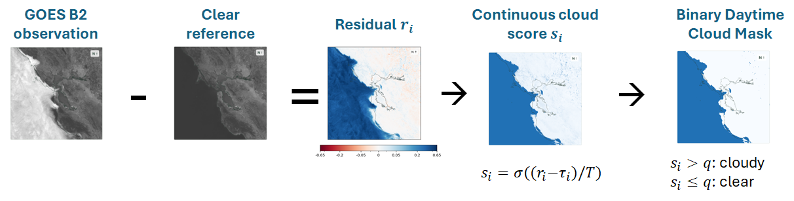
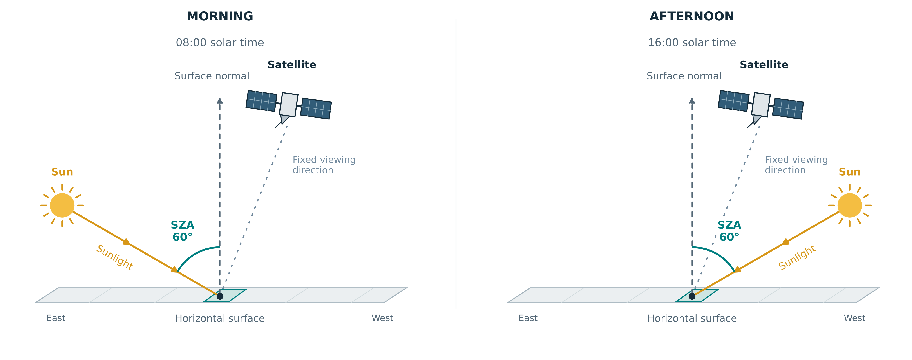
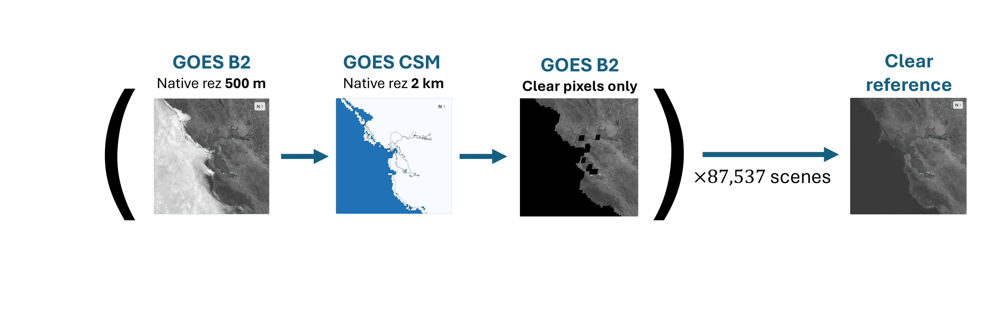
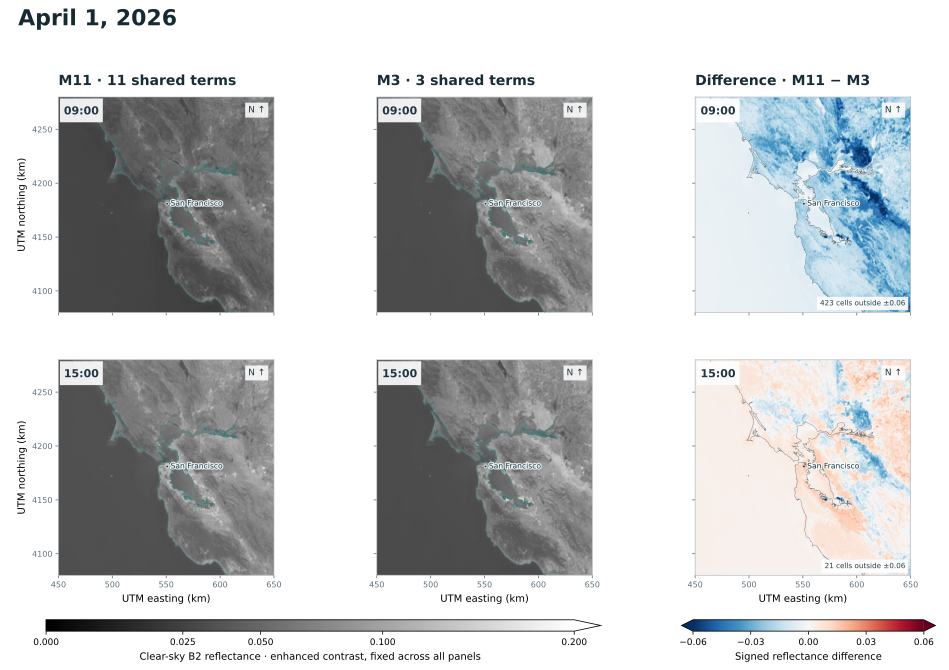
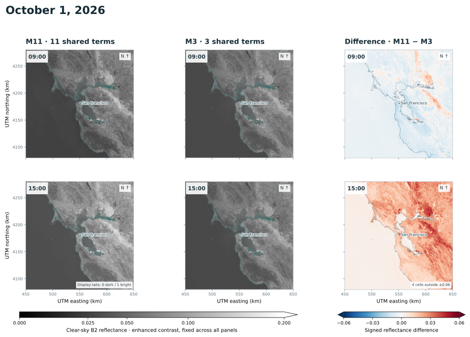
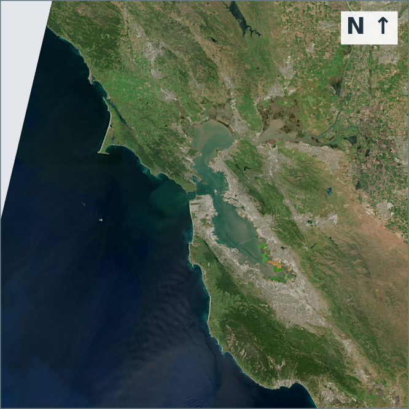
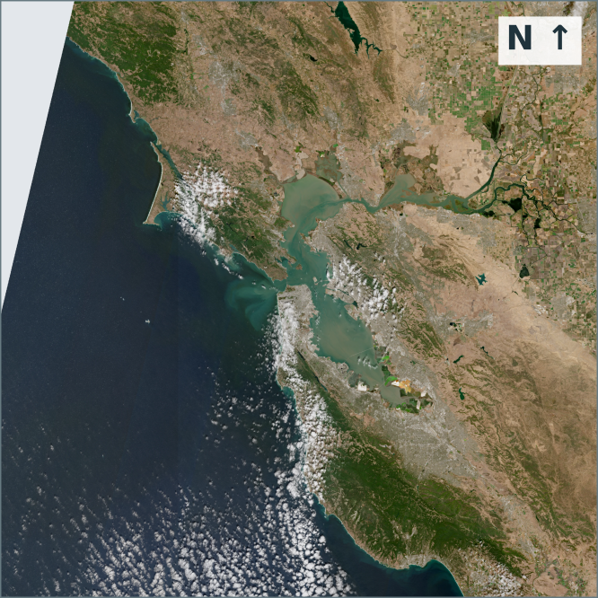
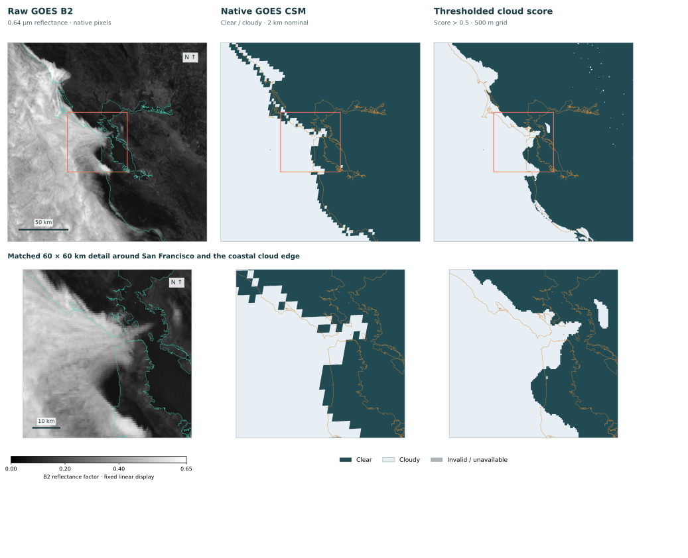

<!-- Source: article-drafts/Post-2_Cloud-Classifier.docx. The publication date is a draft placeholder; update it before publishing. Figures retain their original full images, including annotations cropped out in Word. -->

## Step 1: Estimate what the satellite would see without clouds

A bright pixel is not automatically a cloud. The surface has its own brightness, and that brightness changes with sunlight and season. The idea was to predict what B2 should see under clear conditions, then subtract that reference from the observation. The result is a residual: ideally near zero for clear pixels and positive when clouds make the scene brighter.

This approach gives me something concrete to inspect at every step: the predicted clear scene, the residual, the cloud score, and finally the binary mask. When a shoreline looks suspicious (see [previous post](/writing/building-the-labels/)), I can follow the mistake through those fields.

### Account for sunlight and season

The clear-sky reference predicts how bright the surface should appear as sunlight and season change. I fitted a small regression model at each grid cell, using terms for illumination, time of day, and season.

Every cell uses the same 11-term basis $\varphi$, but has its own fitted coefficients. Those coefficients are shared across GOES-17 and GOES-18, with one additional offset per cell for GOES-18: 12 fitted values in total. The offset accounts for any persistent brightness difference between the two satellite records.

The terms have straightforward interpretations. The solar cosine $c$ captures the sun’s height in the sky. The signed solar-hour term $p$ distinguishes morning from afternoon, when the sun can be equally high but illuminate the surface from different directions, as [Figure 2](#figure-2) illustrates. Annual sine and cosine terms describe smooth seasonal changes. Interaction terms let the daily brightness pattern vary with the season. Together, they give:

$$
R_{\mathrm{clear}} = \beta_{x,y} \cdot \varphi(c,p,d) + b_{18,x,y}\,I(\text{GOES 18})
$$

$$
\begin{aligned}
\varphi = \bigl[&1,\ c,\ c^2,\ p,\ cp,\ \sin(d),\ \cos(d),\\
&c\sin(d),\ c\cos(d),\ p\sin(d),\ p\cos(d)\bigr]
\end{aligned}
$$

where

$$
\begin{aligned}
c &= \cos(\mathrm{SZA})\\
p &= \sin\left(\frac{\pi(h_{\mathrm{solar}}-12)}{12}\right)\\
d &= \frac{2\pi(D_{\mathrm{UTC}}-1)}{N_{\mathrm{days}}}.
\end{aligned}
$$

Here, $\mathrm{SZA}$ is the solar zenith angle, and $h_{\mathrm{solar}}$ is local solar hour, computed from UTC using longitude and an [equation-of-time correction](https://en.wikipedia.org/wiki/Equation_of_time). The annual phase $d$ uses the fractional UTC day of year, $D_{\mathrm{UTC}}$, and the number of days in that year, $N_{\mathrm{days}}$: 365, or 366 in leap years.

The coefficient vector $\beta_{x,y}$ and satellite offset $b_{18,x,y}$ vary by cell. The indicator $I(\text{GOES 18})$ equals one for GOES-18 and zero for GOES-17. Solar geometry and the seasonal cycle guide the choice of terms; observations determine their coefficients.

To fit the reference, I selected clear observations conservatively: the corresponding 3 × 3 neighborhood on the native CSM grid had to be clear in the matched scan and in the scans immediately before and after it. The archive spans about 88,000 candidate scenes from 2019–2026, yielding four billion accepted pixel observations. Neighboring pixels and successive scans are correlated, so those observations do not represent four billion independent examples. [Figure 3](#figure-3) illustrates the process.

<figure id="figure-3" class="clear-reference-schematic">

<figcaption>Figure 3. Building the clear-sky reference. The GOES Clear Sky Mask (CSM) identifies clear regions in B2 imagery. Clear observations collected across many scans provide the data for fitting a model at each grid cell. These models predict the B2 reflectance expected under clear conditions for a given solar geometry and season.</figcaption>
</figure>

Each cell needed at least 12 accepted clear observations on 12 distinct dates to retain its own fit. Where observations were insufficient, I filled the gaps using nearby cells with adequate data and similar land/water composition. Only 48 of the 160,000 grid cells (0.03%) needed this completion, all for the GOES-18 brightness offset. Every cell had enough local observations to fit the shared solar and seasonal pattern.

Before choosing the 11-term basis, I tested smaller subsets to see whether fewer terms could achieve comparable accuracy while reducing the risk of overfitting.

[Table 1](#table-1) compares fits with 3, 5, 7, 9, and 11 terms. Adding time-of-day and seasonal terms improved clear-sky brightness prediction: moving from 3 to 11 terms reduced the held-out RMSE by about 47% for GOES-18 and 26% for GOES-17. These results apply to accepted clear observations; cloud-classification performance requires a separate evaluation.

[Figure 4](#figure-4) compares the three- and eleven-term fits across seasons and times of day, showing how the additional terms change the clear-sky reference. In the examples shown, the eleven-term fit predicts higher clear-sky reflectance in the afternoon than in the morning, and in fall than in spring.

Table 1. Clear-sky reference error on held-out observations, measured as root-mean-square error (RMSE) in B2 reflectance units. Each model shares coefficients across GOES-17 and GOES-18, with a cell-specific GOES-18 offset. All fits are unstabilized except the final row, which applies the stabilization procedure described below.

| Basis                | Terms added at this stage        | Held-out RMSE (GOES-17) | Held-out RMSE (GOES-18) |
| -------------------- | -------------------------------- | ----------------------: | ----------------------: |
| 3 terms              | Constant, $c$, $c^2$             |                0.018420 |                0.015869 |
| 5 terms              | Morning–afternoon $p$ and $cp$   |                0.017056 |                0.013982 |
| 7 terms              | Annual sine and cosine           |                0.014815 |                0.010056 |
| 9 terms              | Illumination × annual phase      |                0.013929 |                0.008876 |
| 11 terms             | Morning–afternoon × annual phase |                0.013666 |                0.008443 |
| 11 terms, stabilized | Same basis                       |                0.013709 |                0.008511 |

<!-- Source editorial context: the table alone does not quantify uncertainty or statistical significance. The source review describes whole-week holdouts with a 48-hour exclusion buffer. -->

<figure id="figure-4">

<figcaption>Figure 4. What the extra terms change. The eleven-terms (M11) and three-terms (M3) references for GOES-18 on April 1 and October 1, 2026, at 09:00 and 15:00 local solar time. The difference maps show where and how much the two fits disagree.</figcaption>
</figure>

[Figure 5](#figure-5) provides some explanations for the seasonal changes in reflectance. In California, fall vegetation is dry, as a result of several months without rain typically, and therefore shows up as yellow/beige, in contrast with vegetation in the spring, which typically after several rain storms during the winter, is green. GOES V2 measures red light, which chlorophyll in healthy green grass strongly absorbs, keeping springtime reflectance low. As grass dries and turns yellow or beige, chlorophyll breaks down, so more red sunlight is reflected. This makes fall grass appear brighter in B2 under clear skies, creating a seasonal change in the clear-sky reflectance baseline.

<figure id="figure-5">

<figcaption>Figure 5. The landscape changes with the seasons. True-color Sentinel-2 scenes acquired near April 1 (left) and October 1 (right) 2026, from Copernicus Browser. The greener spring landscape and drier autumn appearance motivate seasonal terms qualitatively.</figcaption>
</figure>

### Do extra safeguards improve the fit?

With a separate fit at every pixel, a few unusual observations can pull the coefficients around, especially where clear observations are scarce. I tested a stabilized version with three safeguards. First, I gave each UTC date equal weight within each pixel’s satellite record, so days with more images would not dominate. Next, I applied ridge regularization to discourage large solar and seasonal coefficients, leaving the baseline brightness and satellite offset unpenalized. Finally, I refitted once with Huber weights, reducing the influence of observations more than 0.03 reflectance units from the initial prediction.

The extra safeguards slightly worsened both held-out error measures for both satellites ([Table 1](#table-1)). For GOES-18, held-out RMSE rose by about 0.8%. The differences were small, but the simpler fitting procedure had the edge. I kept the unstabilized 11-term fit.

## Step 2: Turn the remaining brightness into a cloud score

### Learn the threshold between clear and cloudy

Subtracting the clear-sky reference leaves a brightness residual. The classifier compares that residual with a fitted threshold that varies with illumination and location. A global quadratic function of solar cosine captures the illumination dependence, while a local offset lets each pixel adjust the threshold. Regularization discourages large local adjustments unless the observations support them:

$$
\begin{aligned}
r_i &= \mathrm{B2}_i - R_{\mathrm{clear},i}\\
\tau_i &= \tau_{\mathrm{global}}(c_i) + \Delta_{x,y}\\
\tau_{\mathrm{global}}(c_i) &= a_0 + a_1 c_i + a_2 c_i^2\\
s_i &= \sigma\left(\frac{r_i-\tau_i}{T}\right).
\end{aligned}
$$

The sigmoid $\sigma$ converts the residual’s distance from the threshold into a cloud score $s_i$ between zero and one. The fitted positive temperature $T$ controls how gradually the score changes around the threshold. A residual above the threshold gives a score above 0.5 and a cloudy label; otherwise, the label is clear.

To fit the classifier, I minimized:

$$
L = \sum_i w_i\,\operatorname{BCE}(y_i,s_i)
+ \frac{\lambda}{P}\sum_j \Delta_j^2.
$$

Here, $y_i$ is the CSM label: zero for clear and one for cloudy. Binary cross-entropy, $\operatorname{BCE}(y_i,s_i)$, penalizes confident mistakes. The weights $w_i$ first give each pixel and UTC date a total base weight of one. Class normalization then assigns half the total fitting weight to clear observations and half to cloudy observations.

The second term penalizes large local offsets $\Delta$. Here, $P$ is the number of offsets, and the selected classifier uses $\lambda = 100$.

For an observation to enter this fit, its corresponding CSM pixel and all eight neighbors must pass quality checks and agree on clear or cloudy. This selects homogeneous regions, reducing ambiguity when pairing coarse CSM labels with finer B2 observations. The drawback is that it also underrepresents cloud edges.

[Figure 6](#figure-6) illustrates the result: a daytime mask that follows the cloud bank visible in B2 while resolving finer spatial structure than native CSM.

### When does sunlight become too weak?

The forecast model uses the fine B2-derived field as both an input and a training target during daytime. Coarse GOES CSM observations remain an input throughout the day and supply the training targets at night.

The switch is necessary because B2 loses contrast as sunlight fades. In [Figure 7](#figure-7), the dashed curves show how often the fitted classifier correctly identifies clear and cloudy observations as a function of the solar zenith angle. As the sun approaches the horizon, cloud recall deteriorates sharply, while clear recall remains high.

To test whether better thresholds could recover the lost performance, I selected a residual threshold separately for each pixel and 1° solar-elevation bin, using the CSM labels themselves to maximize balanced accuracy. The solid curves show the resulting clear and cloud recall. Choosing thresholds using the answers makes these curves optimistic fitting diagnostics, rather than a strict performance ceiling. Even with that advantage, performance drops sharply at similarly low sun angles.

Based on these results, I set the daytime/nighttime cutoff at 82° solar zenith angle, equivalent to 8° solar elevation. This also matches [NOAA’s daytime/nighttime cutoff for cloud optical-property retrievals](https://www.ncei.noaa.gov/metadata/geoportal/rest/metadata/item/gov.noaa.ncdc:C01508/html).

 and cloud recall (red) plotted against solar zenith angle. Dashed curves show the fitted classifier.Solid curves are optimistic fitting diagnostics: thresholds chosen directly from fitting labels to maximize balanced accuracy within each group (,i.e.,  each pixel and 1° solar-elevation bin, separately for sunrise and sunset). The dotted line marks the chosen daytime cutoff of 82° zenith, equivalent to 8° elevation.")

I now had cloud labels from frequent daytime satellite images and coarser CSM labels after dark. The next step was to turn those observations into a ten-hour cloud-cover forecast, building on existing weather guidance. That is the focus of [Part 3: What should a neural network learn when a weather forecast already exists?](/writing/model-architecture/).
