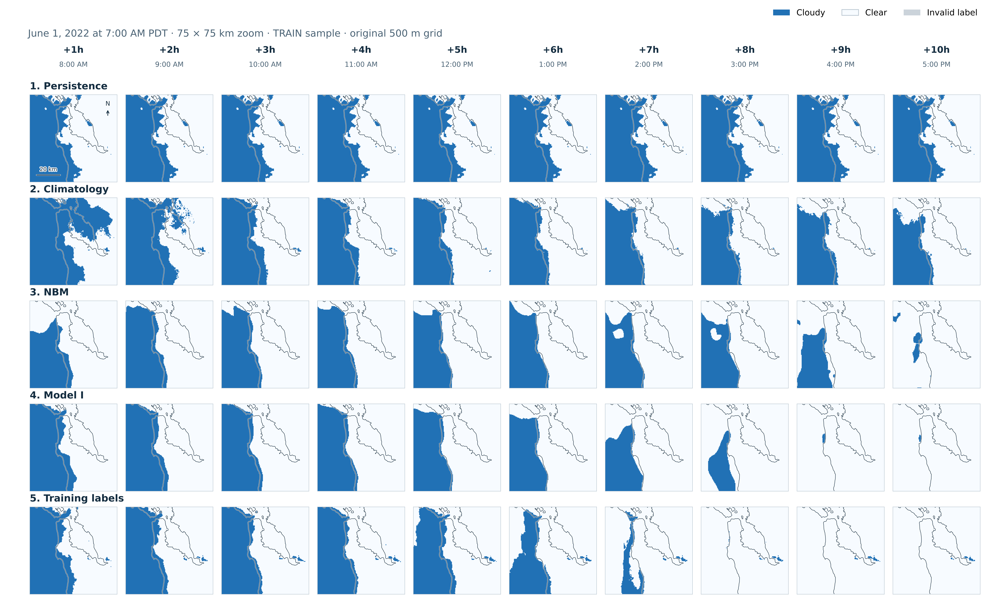
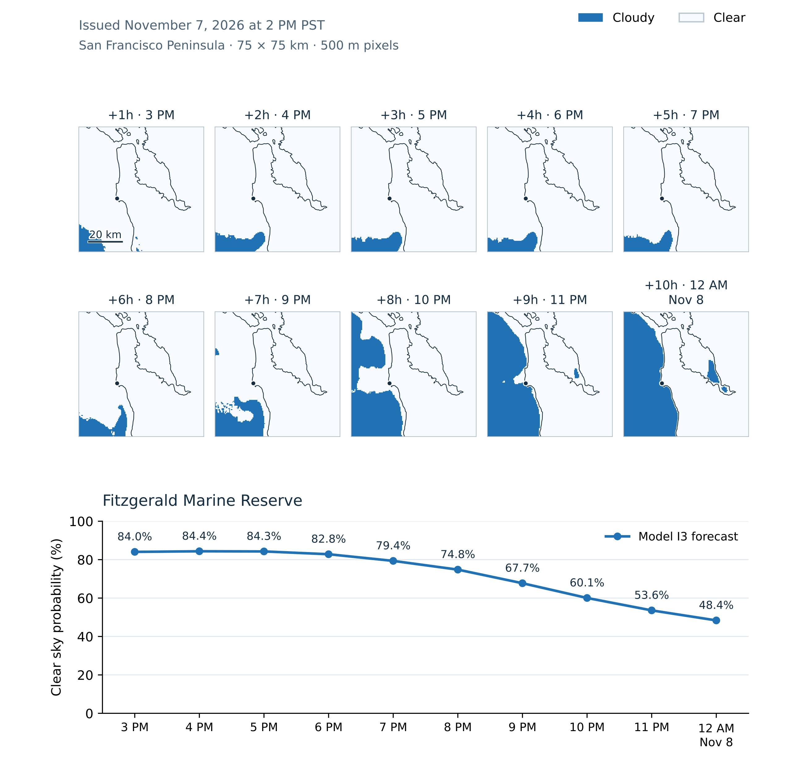

## A sharper map needs evidence

A forecast on a 500 m grid can look persuasive, with enough detail to suggest that the model knows what will happen at that scale. But visual detail alone does not establish forecast accuracy.

In the [previous post](/writing/which-inputs-actually-help/), I selected a three-seed blend of Model I: the original residual U-Net with a wider input domain. Most other variations showed no clear benefit. The next question was whether this model, I3, improves on simpler alternatives and the weather guidance it already receives.

On TEST, it does. I3 has lower Brier scores than persistence, climatology, and direct NBM guidance at every evaluated horizon, day and night. Averaged across the ten forecast hours, its Brier score is about 22% lower than NBM’s during the day and 21% lower at night. The rest of this post explains the comparison and what it tells us about the forecast.

## Three forecasts to beat

The first reference is **persistence**: take the current cloud pattern supplied to the neural network and hold it fixed for all ten forecast hours.

That is a simple assumption, but a useful benchmark. One hour ahead, the latest satellite observations can be a better guide than an older weather forecast.

The second reference is climatology: the historical frequency of clear conditions at each location for the target month and hour, estimated using only TRAIN labels. It captures, for example, how clear skies at Dolores Park differ between 1 p.m. in July and 4 p.m. in October. It knows the typical conditions, but nothing about today’s cloud bank.

The third is NOAA’s **National Blend of Models (NBM)**, used directly. I convert its forecast total sky cover (C), expressed as a percentage, into a clear-sky score:

$$
p_{\mathrm{clear}} = 1 - \frac{C}{100}
$$

This is the weather guidance supplied to Fogcast, evaluated on its own.

## Use the information available at issue time

The age of each input matters. In this historical replay, I use NBM cycles initialized at least two hours before the Fogcast issue time to allow for forecast availability. At 1 p.m., the preferred cycle is therefore 11 a.m. Its prediction for 2 p.m. is already a three-hour forecast, even though that target is only one hour ahead for Fogcast.

Persistence uses the latest eligible satellite observations. Fogcast combines those observations with the earlier NBM forecast. At short leads, part of its task is therefore to update existing weather guidance using newer, finer observations.

## Score the probabilities

The main metric is the **Brier score**, the mean squared difference between the forecast clear-sky probability and the target label: 1 for clear, 0 for cloudy.

For a clear label of 1, a prediction of 0.8 contributes $(0.8-1)^2 = 0.04$, while a prediction of 0.2 contributes $(0.2-1)^2 = 0.64$. Confident mistakes receive a larger penalty.

I score the unthresholded probabilities. Converting them into a hard clear/cloudy map would discard the distinction between a tentative prediction and a confident one.

Daytime comparisons use valid 500 m B2-derived labels. At night and when the Sun is low, I average the fine-grid probabilities over native GOES Clear Sky Mask (CSM) footprints before scoring. The switch occurs at a solar zenith angle of 82°, equivalent to the Sun being 8° above the horizon.

For each horizon, I divide the total squared error by the total valid support. I then average the ten horizon scores equally. Daytime and nighttime results remain separate.

## The model beats all three references

Direct NBM is the strongest reference when averaged across the ten horizons ([Table 1](#table-1)). Persistence performs better than NBM at +1 hour, then deteriorates as the clouds evolve. Climatology stays nearly flat: the target hour changes, but it receives no new information about today’s weather.

Model I3 has lower Brier scores than all three references at every evaluated horizon, day and night ([Figure 1](#figure-1)). Its advantage over direct NBM is largest near issue time and narrows toward +10 hours.

This pattern agrees with the ablations in the previous post. Removing satellite observations hurts most at short leads; removing NBM hurts most at long leads. The combined model benefits from both sources as their relative value changes across the forecast window.

Table 1. Mean TEST Brier score over +1 through +10 hours, with equal weight for each horizon. Lower is better.

| Forecast                        | Daytime · fine | Night · coarse |
| ------------------------------- | -------------: | -------------: |
| Persistence                     |         0.2183 |         0.2084 |
| Climatology                     |         0.2046 |         0.2103 |
| Direct NBM                      |         0.1156 |         0.1332 |
| Model I · three-seed blend (I3) |     **0.0899** |     **0.1057** |

 footprints. I3 has the lowest point score at every evaluated horizon.")

## Watch one forecast unfold

[Figure 2](#figure-2) shows a forecast issued on June 1, 2022, at 7 a.m. PDT, with targets from 8 a.m. to 5 p.m. Persistence repeats the morning cloud pattern. Climatology follows the historical clear frequency for each target hour. Direct NBM uses the cycle initialized at 5 a.m., while Model I3 combines that guidance with the current satellite observations.

The labels show the morning coastal cloud bank retreating through the day. Both NBM and I3 predict substantial clearing, while persistence holds the initial cloud bank in place. The peninsula close-up in [Figure 3](#figure-3) makes the differences easier to inspect.

. Blue: cloudy. Pale: clear. Gray: invalid label. For display, Model I3 is classified as clear at clear-sky probability ≥0.5 and NBM at total cloud cover <36%. These thresholds do not affect the Brier scores.")

## Does 70% clear mean clear about 70% of the time?

The [architecture post](/writing/model-architecture/) left this question open. A sigmoid produces a number between zero and one, but that alone does not make it a trustworthy probability.

A **reliability diagram** groups predictions with similar probabilities and compares their average with the observed clear frequency. If predictions near 70% clear correspond to clear labels roughly 70% of the time, that part of the curve lies near the diagonal.

[Figure 4](#figure-4) shows this check for Model I3. Its daytime curve tracks the diagonal fairly closely. The nighttime curve sits below it through much of the middle range: the model predicts clear conditions more often than the CSM labels support.

The training objective encourages meaningful probabilities. Binary cross-entropy is a strictly proper scoring rule: its expected loss is minimized by predicting the true probability of the label, given the available inputs. If comparable situations are clear 70% of the time, predicting 0.7 gives the lowest expected loss.

That incentive does not guarantee calibration in a trained model. The reliability diagram checks how closely the predictions achieve it on held-out data. Here, Model I3’s daytime results are encouraging, while its nighttime results show room for improvement.

## How good is it then?

Model I3 improves on persistence, climatology, and direct NBM throughout the ten-hour forecast window. Against NBM, the strongest reference, its mean Brier score is about 22% lower during the day and 21% lower at night.

There are limits to what these results tell us. “Cloudy” here means detectable cloud at any height, which does not necessarily mean fog at ground level. Daytime accuracy is measured against B2-derived labels, which have their own errors. At night, verification uses native CSM footprints, with a nominal resolution of 2 km, so it cannot independently establish the accuracy of individual 500 m cloud edges.

Within those limits, the forecast gives me something useful for planning an afternoon. I can follow the predicted clear-sky probability at Ocean Beach through sunset, compare it with Dolores Park, and decide how much uncertainty I am willing to accept.

As I write this, I’m about to head out with my wife to explore the tide pools at Fitzgerald Marine Reserve. The forecast in [Figure 5](#figure-5) suggests we’ll get some sunshine!

The latest forecast is available at [fogcast.today](https://fogcast.today/). Give it a try next time you’re planning an afternoon outside.
