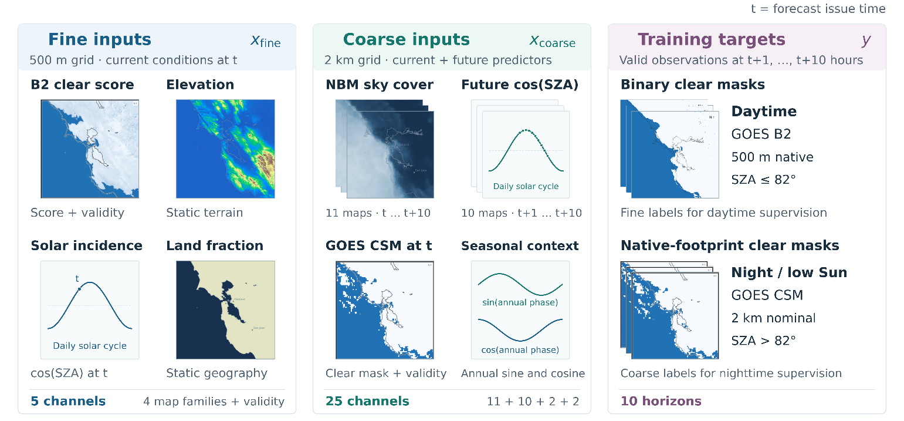
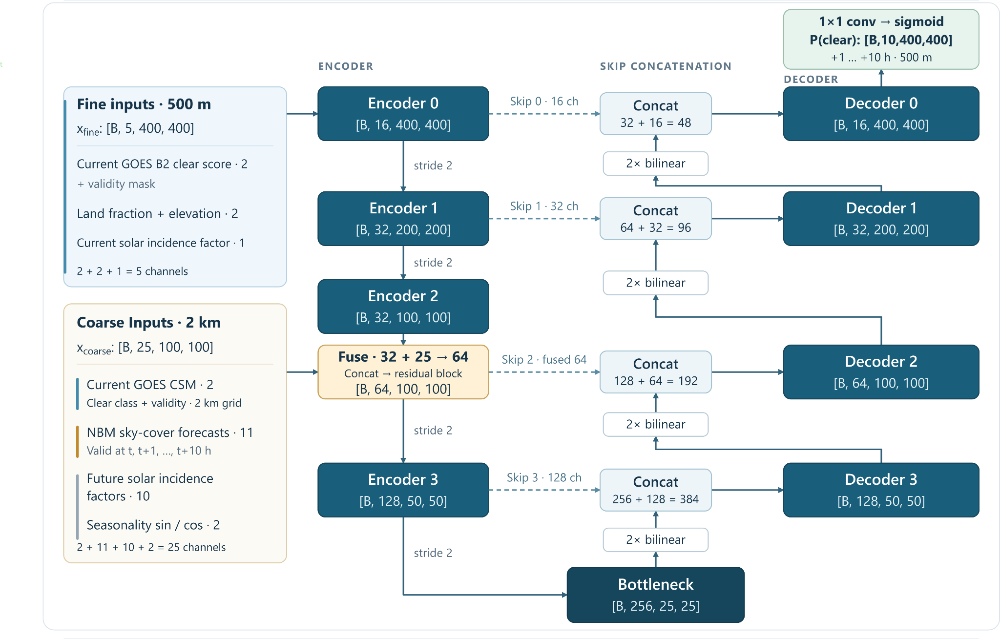
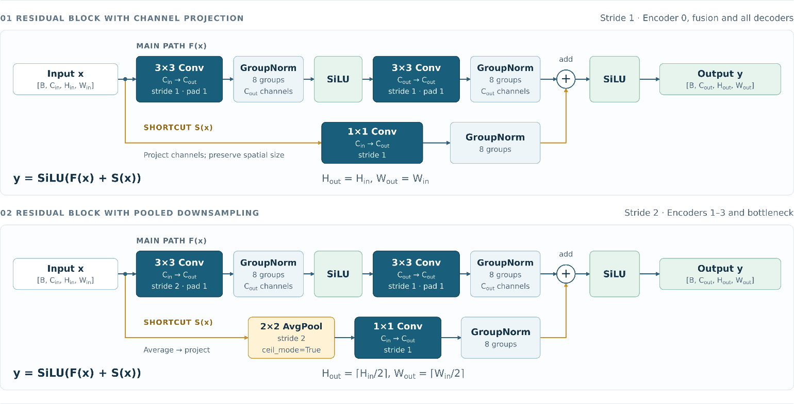
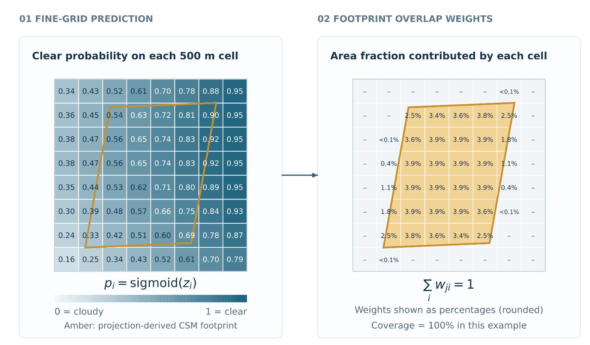

<!-- Source: article-drafts/Post-3_Model-Architecture.docx. The publication date is a draft placeholder; update it before publishing. Figures are extracted from the Word draft. -->

## From a cloud map to a forecast

By the end of the last post, I could turn daytime satellite images into maps of clear and cloudy conditions. But the question that started this project was still waiting: would the clouds clear before we got to the beach?

An existing weather forecast already has something to say about that. The National Blend of Models (NBM) provides hourly cloud-cover forecasts. Meanwhile, the satellite shows the cloud pattern over the Bay Area right now, with much finer spatial detail. I wanted a model that could use both: the high-resolution local observations and a forecast of how the weather might evolve.

That led to the choice of a residual U-Net for the architecture. Its design follows three practical questions: what information can I give it, how can it combine different spatial scales, and how can I teach it when the available labels change between day and night? This post follows those choices for the baseline model, Model A.

## Ten maps for the next ten hours

The model produces ten maps, one for each forecast hour from +1 to +10. Each covers a 200 × 200 km area around San Francisco on a 400 × 400 grid, with cells 500 m across. As in the first two posts, “clear” means no detectable cloud in the satellite label. “Cloudy” includes cloud at any height, from fog at ground level to high cirrus. Fogcast predicts whether cloud will be present, without distinguishing its type or altitude.

For every cell and hour, the network produces a real-valued score called a logit. A sigmoid converts that score into a clear-sky probability between zero and one: values near one favor clear conditions; values near zero favor cloud. Probabilities let the model express uncertainty about where a cloud edge will lie or when a cloud bank will dissipate. Whether those probabilities are well calibrated is a question we’ll answer later.

During training, a differentiable loss compares the continuous scores with the observed labels and provides gradients that guide learning. Applying a hard clear/cloudy cutoff before computing the loss would block those useful gradients. The model therefore learns from its continuous output, without first turning it into a binary map.

All ten maps come from a single forward pass. The model predicts each hour directly from the inputs, so the +2-hour forecast does not depend on feeding the +1-hour prediction back into the network.

## A close-up of now, a broader view of what comes next

The inputs come in two groups, both covering the same 200 × 200 km domain. The fine group contains five maps on the 500 m grid: the current B2-derived clear score, its validity mask, land fraction, elevation, and current solar incidence. Each map forms one input channel.

The current clear score is continuous: it is one minus the cloud score developed in Post 2, preserving how strongly the classifier favors clear or cloudy conditions. The validity mask identifies where that score is usable. Future daytime training targets, by contrast, are binary clear/cloudy labels obtained by applying the classifier’s fixed cutoff.

The coarse group uses a 100 × 100 grid with 2 km cells. Its 25 channels provide eleven NBM cloud-cover forecast maps, ten maps of future solar incidence, the current GOES Clear Sky Mask (CSM) and its validity mask, and annual sine and cosine terms that describe the time of year. Figure 1 shows the inputs alongside the future observations used as training targets; Table 1 details what each input contributes.

Table 1. Baseline model inputs and their roles. Fine inputs use a 400 × 400 grid with 500 m cells; coarse inputs use a 100 × 100 grid with 2 km cells. Both cover the same 200 × 200 km domain.

| Grid / input group           | Fields                                      | Channels | What they contribute                                |
| ---------------------------- | ------------------------------------------- | -------: | --------------------------------------------------- |
| Fine · current observation   | B2-derived clear score + validity mask      |        2 | Current daytime cloud structure and usable coverage |
| Fine · geography             | Land fraction + elevation                   |        2 | Coastline and terrain context                       |
| Fine · solar context         | Solar incidence at issue time               |        1 | Current illumination                                |
| Coarse · external forecast   | NBM total cloud cover, $t$ through $t+10$ h |       11 | Predicted cloud-cover evolution                     |
| Coarse · solar context       | Solar incidence, $t+1$ through $t+10$ h     |       10 | Daylight geometry at each forecast hour             |
| Coarse · current observation | CSM clear mask + validity mask              |        2 | Current cloud structure, including at night         |
| Coarse · season              | Annual sine + cosine at issue time          |        2 | Smooth seasonal context                             |

## What could I actually know at 1 p.m.?

Suppose Fogcast issues a forecast at 1 p.m. Its inputs can describe future conditions, but they must already be available at that time. A weather forecast for 5 p.m. published at noon is fair game; one published at 3 p.m. would leak future information into the prediction.

For satellite inputs, I select the latest eligible scan completed by the issue time $t$, with a midpoint no more than 20 minutes old.

For NBM, the preferred input is a single complete forecast cycle initialized two hours before $t$. This lag allows time for the forecast series to be generated and published, which typically takes abou 60 minutes. I take all eleven maps, covering $t$ through $t+10$ hours, from that cycle. The historical replay uses the same two-hour allowance to approximate what would have been available when each forecast was issued.

Table 2. Input and target selection for a forecast issued at 1 p.m. Future satellite observations are used only for training and evaluation.

| Data                      | Selection rule                                                                                | 1 p.m. example                                                   |
| ------------------------- | --------------------------------------------------------------------------------------------- | ---------------------------------------------------------------- |
| Current B2 and CSM inputs | Latest eligible scan completed by $t$, with a midpoint between $t-20$ min and $t$.            | Scan completed by 1 p.m., with a midpoint at or after 12:40 p.m. |
| NBM inputs                | Prefer the cycle initialized at $t-2$ h; use its eleven maps valid from $t$ through $t+10$ h. | Use the 11 a.m. cycle forecasts valid from 1 through 11 p.m.     |
| Future B2 / CSM targets   | Nearest eligible observation with a midpoint within ±6 min of each target hour.               | The +1-hour target has a midpoint between 1:54 and 2:06 p.m.     |

These timing rules define what the model can learn from and what it must predict. It receives recent satellite observations and weather forecasts already available at issue time. Later satellite observations supply the targets for training and evaluation.

## Zoom out for context, zoom back in for detail

A cloud boundary is local, but its evolution depends on patterns from a wider region. I chose a U-Net to combine those scales: its encoder builds broader features, then its decoder reconstructs a detailed forecast ([Figure 2](#figure-2)).

In Model A, the fine inputs begin at 400 × 400 cells. After two downsampling stages, their learned features reach 100 × 100, matching the coarse input grid. That is where the network joins them: 32 learned feature channels are concatenated with the 25 coarse channels, then processed into 64 channels.

Successive convolutions with 3 × 3 kernels combine neighboring features, while downsampling lets those kernels operate over progressively larger areas of the original scene, with the bottleneck representing the scene at 25 × 25 cells. Together, these operations allow deeper features to capture broader spatial context. On the way back up, the decoder uses bilinear upsampling and joins features from the matching encoder level. Those U-Net skip connections carry spatial information that would likely be harder to recover from the bottleneck alone.

Convolutions also reuse the same learned filters across the map. A useful local pattern can therefore be recognized in different places. Geography channels let the model interpret that pattern in the setting of ocean, shoreline, or elevated terrain. This is the design assumption: shared ways of recognizing patterns, informed by local context.

### Two kinds of shortcuts

The word “residual” in “residual U-Net” refers to shortcuts inside each processing block. U-Net skip connections carry spatial detail from the encoder to the matching decoder level, helping reconstruct a detailed forecast. Residual shortcuts carry a version of a block’s input around its convolutions and add it to the transformed features. This lets each block retain useful information while learning how to change it, making the network easier to train.

## Learning from labels that change with the light

The network always predicts on the 500 m grid, but its training labels change with the sunlight. In usable daylight, the B2 classifier supplies fine binary labels. At night, CSM supplies labels on its native, coarser satellite footprints. The loss must compare predictions with each source at the resolution it supports.

Both comparisons use binary cross-entropy (BCE). With $y=1$ for clear, $y=0$ for cloudy, and $p$ for the predicted clear-sky probability, the loss for one label is:

$$
\operatorname{BCE}(y,p)=-y\log(p)-(1-y)\log(1-p)
$$

In daylight, I apply this loss separately to every valid fine pixel. These labels are used at solar zenith angles up to 82°, when the Sun is at least 8° above the horizon. The choice of supervision follows the target time: a forecast issued during daylight may predict nighttime conditions later in its ten-hour window.

For each nighttime CSM label, I first average the model’s fine-grid probabilities over its native footprint, weighting each cell by its area of overlap. I then compare that average with the binary CSM label. This pooling happens after the sigmoid, so it averages probabilities rather than logits. [Figure 4](#figure-4) illustrates the overlap weights.

I precompute the overlap weights and reuse them during training. Gradients pass through the weighted average to the fine-grid predictions.

This lets the model learn from CSM without treating a coarse footprint as many independent 500 m labels. It also limits what CSM can establish: different fine-scale cloud patterns can produce the same footprint average.

### Combining the two sources of supervision

Daytime labels contribute to the fine loss; nighttime CSM labels contribute to the coarse loss. I average each source separately and give the coarse term one-quarter the weight of the fine term:

$$
\begin{aligned}
F_h &= \frac{1}{N_{F,h}}\sum_i \operatorname{BCE}(y_{i,h},p_{i,h}) \\
C_h &= \frac{1}{N_{C,h}}\sum_j \operatorname{BCE}(y_{j,h},\bar{p}_{j,h}) \\
L &= \frac{1}{N_H}\sum_{h\in H}\left(F_h+0.25\,C_h\right)
\end{aligned}
$$

At each forecast horizon $h$, $F_h$ is the mean loss over all valid fine pixels across the batch, and $C_h$ is the mean loss over all valid CSM footprints. Their counts are $N_{F,h}$ and $N_{C,h}$; $\bar{p}_{j,h}$ is the pooled clear-sky probability for footprint $j$.

Averaging each source separately lets me set their relative weights explicitly, without the much larger number of fine pixels determining the balance. I chose a coarse-loss weight of 0.25 to prioritize daytime accuracy, the main focus of this project. The final loss $L$ averages the combined terms over the $N_H$ forecast horizons in $H$.

## The model is specified. Which choices actually help?

Current satellite observations supply local evidence, NBM supplies a forecast of cloud-cover evolution, and the U-Net combines them across scales. Daytime and nighttime labels train the same ten-hour output, with each comparison made at the resolution the labels support.

How much do these design choices matter? Do land fraction and elevation improve the forecast? Would satellite imagery from an hour earlier provide useful context? Would an attention block help? In [Part 4. Which inputs actually help?](/writing/which-inputs-actually-help/), I test these and other choices to find out which ones earn their place in the model.
