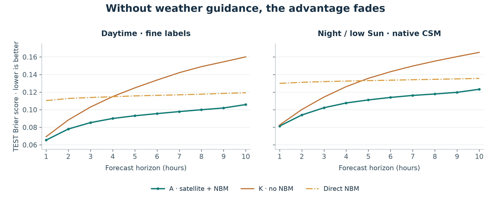
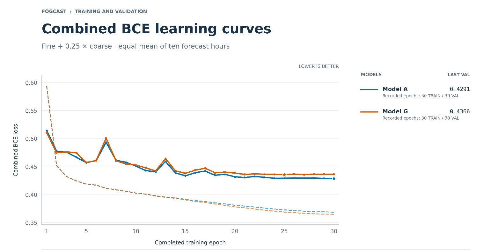
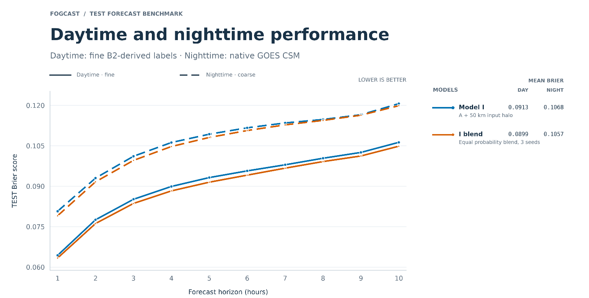

## Which ideas survived the test?

A previous satellite image might reveal cloud movement. A forecast uncertainty map might tell the network when to distrust the weather guidance. Attention might help it connect patterns across the map. Each addition sounded useful. Most did not produce a clear improvement.

In the [last post](/writing/model-architecture/), I described Model A: a residual U-Net that combines current satellite observations, NOAA’s National Blend of Models (NBM) cloud-cover forecasts, and geographic maps to predict the next ten hours around San Francisco. Here, I test which parts of that recipe matter and whether adding more information helps. The experiments compare ten architectures, including A, and two three-model blends.

The clearest evidence came from taking inputs away. Removing satellite observations, NBM guidance, or geography made the forecast worse. Adding inputs or attention was harder to justify. The most promising refinement combined a wider input domain with an average of three trained models, improving the nighttime forecast.

## How I compared the models

Each architecture changes one aspect of A. I trained every variant from scratch with the same learning-rate and regularization recipe, then selected checkpoints by validation binary cross-entropy (BCE). This compares the changes under a common training setup; it does not find the best settings for each architecture.

The evaluation uses all 5,219 TEST forecast issues. I score the predicted clear-sky probabilities with the Brier score, the mean squared difference between a probability $p$ and its corresponding label $y$, where 1 means clear and 0 means cloudy:

$$
\operatorname{Brier} = \frac{1}{N}\sum_{i=1}^{N}(p_i-y_i)^2.
$$

Lower is better; a perfect forecast scores zero. The reported means give equal weight to all ten forecast horizons, from +1 to +10 hours.

During daytime, I compare predictions with valid 500 m B2-derived labels. At night and under low Sun, I first average the predictions over native Clear Sky Mask (CSM) footprints, which have a nominal resolution of 2 km. The two evaluation regimes meet at a solar zenith angle of 82°, when the Sun is 8° above the horizon.

[Figure 1](#figure-1) shows score differences relative to Model A trained with seed 42, abbreviated A42. Negative values mean lower error. The bars show approximate 95% uncertainty intervals that combine weather sampling and variation between training seeds. If an interval crosses zero, this calculation does not resolve whether the change helps or hurts. The [uncertainty note](#a-note-on-the-uncertainty) explains the assumptions.

## Start with the satellite observations

Model B removes both current satellite inputs and their validity masks. It still receives NBM forecasts, geographic maps, and solar and seasonal context, but loses its direct view of the current clouds.

The penalty is clear: mean Brier score rises by 0.0105 in daytime and 0.0162 at night relative to A42. The gap is largest at short leads, when a recent observation should be most useful ([Figure 2](#figure-2)).

Model D asks a narrower question: how much does the fine imagery add? It removes the 500 m B2-derived clear score and its validity mask while keeping the 2 km CSM observations. Daytime error rises by 0.0028, with an interval entirely above zero. The nighttime difference is small and unresolved.

Keeping coarse satellite observations therefore preserves much of A’s performance. The fine daytime imagery provides a further benefit when evaluated against the fine daytime labels.

For reference, the plots also show **direct NBM**: the NBM cloud-cover forecast used on its own, converted to a clear-sky score as $1 - \mathrm{cloud\ cover}/100$.

 preserves much of A’s performance, with a clear daytime penalty.")

## A satellite snapshot is not enough for ten hours

Model K keeps the satellite observations but removes all eleven NBM cloud-cover maps. I expected the forecast to suffer, especially at longer leads.

For the first few hours, K still beats direct NBM. Around four to five hours ahead, that advantage disappears, and its error rises much faster than A’s. Across the ten horizons, removing NBM increases mean Brier score by 0.0327 in daytime and 0.0245 at night, the largest penalties in these experiments.

The observations provide a detailed starting point; NBM provides guidance about what happens next. Both contribute to the combined forecast.

## Geography helps, too

Model J removes land fraction, the fraction of each cell covered by land, and elevation. These maps provide geographic context: clouds over the ocean may behave differently from clouds over Mount Tamalpais.

Removing the maps raises mean Brier score by 0.0026 in daytime and 0.0029 at night. Both intervals exclude zero. The experiment does not explain how the network uses geography or separate the contributions of the two maps, but it supports keeping them in the model.

## Three plausible additions without a clear gain

Model C adds the previous hour’s satellite fields and validity masks. Two snapshots might help the network infer cloud movement, growth, and dissipation. Instead, its scores are slightly worse than A42’s, with both intervals crossing zero. The experiment did not establish a benefit. NBM may already provide some of the useful information about cloud evolution, but this comparison cannot confirm that explanation.

Model E adds NBM ensemble sky-cover spread and a validity mask, giving the network a measure of disagreement in the weather guidance. Model F adds probabilities of a cloud ceiling below 3,000 ft, supplementing A’s total cloud-cover forecasts. Neither produces a conclusive improvement under the common training recipe.

## Does more spatial context help?

Through its convolution paths, Model A has an approximate one-sided reach of 43 km in each cardinal direction, much less than the domain’s 200 km width. I tested two ways to provide more spatial context.

Model G adds four-head spatial attention at the bottleneck, allowing features at distant locations to interact directly. Nighttime Brier score rises by 0.0026, with an interval entirely above zero. The daytime difference remains unresolved.

The learning curves offer a clue ([Figure 4](#figure-4)). G eventually reaches lower training loss but higher validation loss than A, consistent with fitting relationships that do not generalize. The common training recipe may also suit G poorly; these experiments do not distinguish those explanations.

Model I expands the input domain instead. It adds a 50 km margin on every side, so the network sees 300 × 300 km while forecasting the central 200 × 200 km. The margin extends beyond the approximate convolutional reach, providing observed context around the output boundary.

I has a lower nighttime point score, but its interval relative to A42 still crosses zero. The wider domain is promising, although this comparison alone does not establish that boundary effects hurt the baseline.

## Can three models do better than one?

I trained A and I with three random seeds each, then averaged each group’s clear-sky probability maps at every location and forecast hour. These blends are A3 and I3. Their scores measure the error of the averaged probabilities, rather than the average error of their members.

When members disagree, averaging can soften a confident error. It does not guarantee a better prediction than the best member on every sample.

Both blends have lower point scores than A42. A3’s intervals cross zero in both regimes. I3 provides the clearest improvement: its nighttime interval lies entirely below zero, although its daytime interval still crosses zero.

I chose I3 for the final model: the wider input domain, with predictions averaged across three training seeds. It is a modest refinement of A, with the strongest evidence of improvement at night.

The experiments also support the original choice of inputs. Current satellite observations, NBM guidance, and geography all improve the forecast. Solar and seasonal context remain in the recipe, although I did not test removing them. Most additions fail to show a clear gain under this training setup.

With those choices made, the next question is practical: how much better is the forecast than existing weather guidance, or simply assuming the clouds will stay where they are? That is the focus of [Part 5. Is the neural network better, or does it just draw prettier maps?](/writing/does-fogcast-earn-its-detail/).

## The experiment ledger

Table 1. Each change is relative to architecture A. Values are mean TEST Brier-score differences from A42, followed by approximate 95% intervals. Negative is better; A42’s self-comparison is zero. I reports the mean across three training runs. A3 and I3 report scores of averaged probability maps. The remaining variants each use one training run.

| Model | Change from A                              | Daytime difference [95% interval] | Night / low-Sun difference [95% interval] |
| ----- | ------------------------------------------ | --------------------------------- | ----------------------------------------- |
| A3    | Blend three A probability maps             | −0.0005 [−0.0018, +0.0008]        | −0.0009 [−0.0021, +0.0003]                |
| B     | Remove both satellite inputs + masks       | +0.0105 [+0.0066, +0.0144]        | +0.0162 [+0.0126, +0.0198]                |
| C     | Add previous-hour satellite inputs + masks | +0.0011 [−0.0010, +0.0032]        | +0.0005 [−0.0016, +0.0025]                |
| D     | Remove fine B2 score + mask; keep CSM      | +0.0028 [+0.0007, +0.0049]        | +0.0004 [−0.0017, +0.0025]                |
| E     | Add NBM ensemble sky-cover spread + mask   | −0.0004 [−0.0028, +0.0020]        | −0.0003 [−0.0025, +0.0018]                |
| F     | Add NBM low-ceiling probabilities + masks  | −0.0009 [−0.0034, +0.0016]        | +0.0004 [−0.0017, +0.0026]                |
| G     | Add four-head bottleneck attention         | +0.0015 [−0.0009, +0.0040]        | +0.0026 [+0.0004, +0.0048]                |
| I     | Expand input domain to 300 × 300 km        | +0.0001 [−0.0020, +0.0023]        | −0.0015 [−0.0035, +0.0004]                |
| I3    | Blend three I probability maps             | −0.0014 [−0.0034, +0.0006]        | −0.0030 [−0.0049, −0.0012]                |
| J     | Remove land fraction + elevation           | +0.0026 [+0.0004, +0.0048]        | +0.0029 [+0.0007, +0.0051]                |
| K     | Remove all eleven NBM cloud-cover maps     | +0.0327 [+0.0255, +0.0399]        | +0.0245 [+0.0190, +0.0300]                |

## A note on the uncertainty

The intervals combine two sources of uncertainty. Weather-sampling uncertainty comes from 10,000 paired TEST resamples, stratified by season. Each model is scored on the same weather selections, so the comparison tracks how their score difference varies across those samples.

Training-seed uncertainty is estimated from three runs each of A and I. A pooled seed-variance estimate is also applied to variants trained only once. The calculation assumes weather and seed effects are independent and additive, then adds their variances. Each interval is the paired score difference ± 2.78 times the combined standard error. The multiplier uses the four degrees of freedom in the pooled seed estimate. For A3 versus A42, the calculation also accounts for their shared member.

These are approximate intervals. With only three seeds for each reference architecture, applying a common variance estimate to other variants requires assumptions about how training variability transfers between models. An interval crossing zero means the experiment did not resolve the difference, not that the change could never help.
